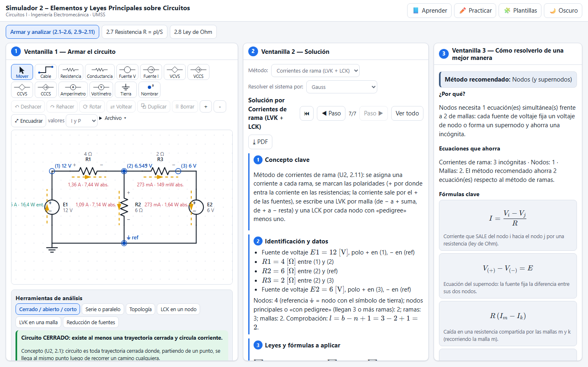
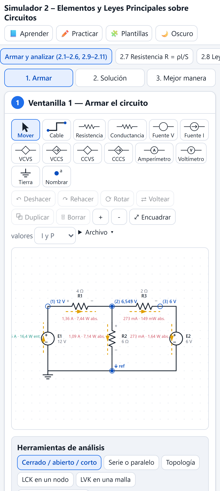

# Simulador 2 – Elementos y Leyes Principales sobre Circuitos

Simulador web interactivo de la **Unidad 2 de Circuitos I** (sigla 197900021, Ingeniería Electromecánica, UMSS – Cochabamba, Bolivia; docente Ing. Abg. Juan Antonio Rodríguez Sejas). Se arma cualquier circuito con fuentes independientes y dependientes y se ve en vivo si funciona: corrientes, voltajes, potencias, leyes de Kirchhoff y método de corrientes de rama. Si el circuito tiene un error, el simulador explica qué pasa, por qué y cómo corregirlo.

**Página publicada:** https://angelja19.github.io/simulador-2-elementos-y-leyes/

| Escritorio | Celular |
| --- | --- |
|  |  |

## Cómo se usa

La pantalla tiene tres ventanillas (en el celular se cambia de una a otra con botones):

1. **Armar el circuito**: un editor gráfico con resistencia, conductancia, fuentes de voltaje y de corriente, las cuatro dependientes (VCVS, VCCS, CCVS y CCCS), amperímetro, voltímetro y tierra. Se puede arrastrar, rotar, voltear, borrar, deshacer y rehacer; guardar y cargar en JSON; exportar a PNG o SVG; y compartir el circuito con un enlace. El circuito se simula en vivo con flechas de corriente animadas y muestra si cada elemento absorbe o entrega, el balance de potencias y los residuos de LCK y LVK. Debajo está el **panel de errores**.
2. **Solución**: el desarrollo en 7 puntos por corrientes de rama (como en el punto 2.11 del curso), por nodos o por mallas. El sistema se resuelve por Gauss, Cramer o sustitución, a elección.
3. **Cómo resolverlo de una mejor manera**: qué método conviene y cuántas ecuaciones ahorra, atajos de examen y errores típicos.

También tiene **Aprender**, **Practicar**, **Plantillas** y tema claro u oscuro.

## Funciones por subtema

- **2.1 Concepto de circuito:** indica si el circuito está cerrado, abierto o en corto.
- **2.2 Serie y paralelo:** se tocan dos elementos y dice si están en serie, en paralelo o ninguno, y por qué, mostrando I igual en serie y V igual en paralelo.
- **2.3 Topología:** cuenta y resalta nodos, nodos principales, ramas, mallas y lazos, y verifica l = b − n + 1. También muestra el árbol y el co‑árbol.
- **2.4 Fuentes:** independientes y las cuatro dependientes, con su variable de control indicada en el dibujo.
- **2.5–2.6 Conexión y reducción de fuentes:** las fuentes de voltaje en serie se suman con su signo y las de corriente en paralelo también. Las combinaciones prohibidas (V distintas en paralelo, I distintas en serie) disparan el validador.
- **2.7 Resistencia:** R = ρ·l/S con una tabla de resistividades (Serway y Boylestad) y conversión de Ω·mm²/m a Ω·m, más G = 1/R y la curva I–V.
- **2.8 Ley de Ohm:** se cambia V o R y se ve la corriente y la recta I–V.
- **2.9–2.10 Kirchhoff:** se toca un nodo y aparece su LCK con valores; se toca una malla y una animación arma la LVK término a término con los signos del curso (de − a + suma, de + a − resta).
- **2.11 Método de corrientes de rama:** LVK más LCK, también con fuentes dependientes.

## El validador detecta

Circuito abierto, terminal suelto, componente aislado o nodo flotante, falta de tierra (la asigna y avisa), fuente de voltaje en corto, fuentes de voltaje distintas en paralelo, fuentes de corriente distintas en serie, fuente de corriente en circuito abierto, valores inválidos o mal escritos, fuentes dependientes sin control, sistemas singulares o mal condicionados, y amperímetro o voltímetro mal conectados. Además da advertencias por potencias exageradas, elementos en corto y elementos sin corriente.

## Casos verificados por las pruebas

| Caso | Resultado |
| --- | --- |
| Cuaderno, fuente dependiente 5Iₓ: 500 − 5I₁ − 20I₂ = 0; I₁ + I₃ = I₂; I₃ = 5I₁ | I₁ = 4 A, I₃ = 20 A, I₂ = 24 A, V₀ = 480 V |
| EJ1 método de ramas (6Iₓ, 20 mA) | V₀ = −13,58 V |
| Circuitos aleatorios | ramas = nodos = mallas = MNA; balance de potencias y residuos de LCK/LVK iguales a 0 |

Las fórmulas y la notación salen del material del curso; están resumidas en [`docs/formulas.md`](docs/formulas.md).

## Ejecutarlo en su computadora

```bash
npm install
npm run dev
```

## Pruebas

```bash
npm test                     # motor, casos del cuaderno y cálculos (Vitest)
npx playwright install chromium
npm run test:e2e             # interfaz en escritorio (1440×900) y celular (412×915)
```

## Licencia

[MIT](LICENSE)
